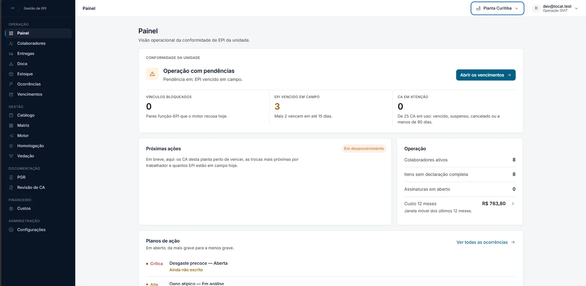
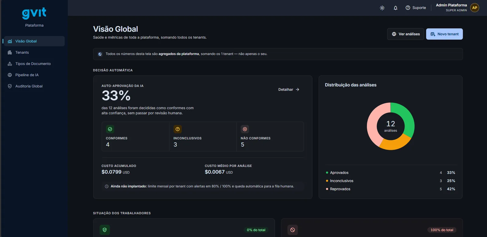
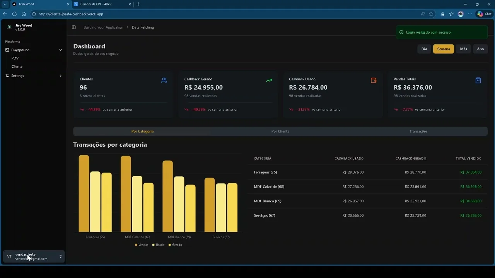
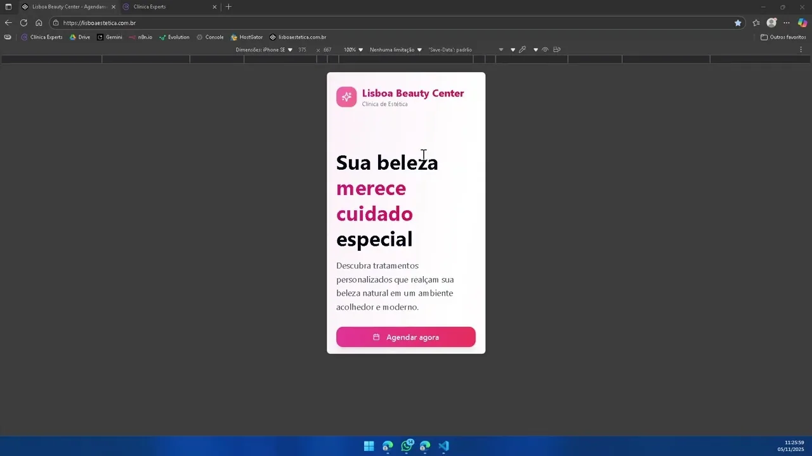
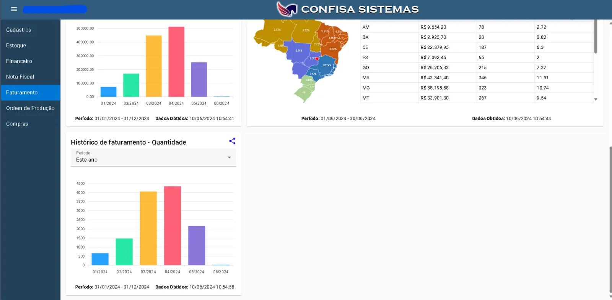
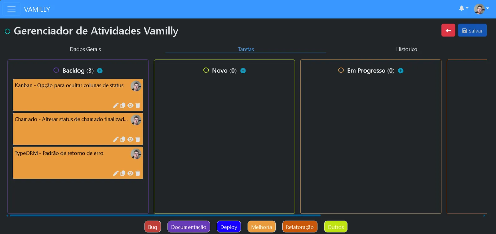
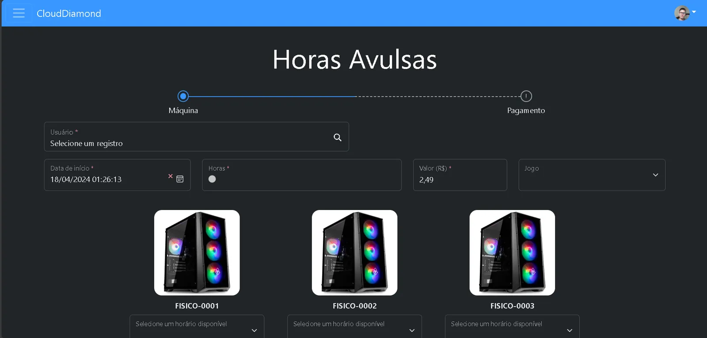

<h1 align="center">Olá, eu sou o David Marques 👋</h1>

<p align="center">
  Desenvolvedor Full Stack · Brasil
</p>

<p align="center">
  <a href="https://www.davidmarques.com.br/"></a>
  <a href="https://www.linkedin.com/in/davidmarques123/"></a>
  <a href="mailto:dev.davidmarques@gmail.com"></a>
  <a href="https://wa.me/5542999027693"></a>
  <a href="https://www.99freelas.com.br/user/davidmarques-dev"></a>
</p>

## Sobre mim

Desenvolvedor Full Stack com foco em **integrações de sistemas** e **automação de processos**.

- 🔌 Construo APIs e integrações entre plataformas — ERP, sistemas web e serviços externos
- 🤖 Uso inteligência artificial para ganho de produtividade e geração de valor
- 🧭 Atuo do levantamento de requisitos com clientes à implementação e sustentação das soluções
- 🎯 Foco em eficiência, escalabilidade e resolução de problemas reais
- ⭐ Cerca de 6 anos de experiência · 24 projetos concluídos como freelancer, com nota 4,71 em 25 avaliações na [99Freelas](https://www.99freelas.com.br/user/davidmarques-dev)
- 🗣️ Português nativo · Inglês básico

## Projetos em destaque

<table>
  <tr>
    <td colspan="3" valign="top">
      
      <br /><strong>GVIT EPI</strong>
      <br /><sub>Gestão e entrega de EPI com motor de regras que confere CA, risco da função e prazo de troca antes de cada entrega, com vencimentos, ocorrências e ficha NR-06 · Next.js, NestJS, PostgreSQL, Claude SDK, Docker, Portainer e GitHub CI/CD</sub>
    </td>
  </tr>
  <tr>
    <td colspan="3" valign="top">
      
      <br /><strong>GVIT Gestão de Terceiros</strong>
      <br /><sub>Gestão multi-tenant de colaboradores e documentos de terceiros, com quarteirização, pré-análise de documentos por IA e validação humana · perfis de admin, contratante, avaliador e prestadora · Next.js, NestJS, PostgreSQL, Claude SDK, Docker, Portainer e GitHub CI/CD</sub>
    </td>
  </tr>
  <tr>
    <td width="33%" valign="top">
      <a href="https://www.youtube.com/watch?v=nIiooEnrTe8"></a>
      <br /><strong>Sistema de Cashback</strong>
      <br /><sub>Cashback sob medida para indústria de MDF: créditos a cada pedido para usar em compras futuras e campanhas · <a href="https://www.youtube.com/watch?v=nIiooEnrTe8">vídeo</a></sub>
    </td>
    <td width="33%" valign="top">
      <a href="https://www.youtube.com/watch?v=uS0W-OkU1YI"></a>
      <br /><strong>Agendamento para Clínicas de Estética</strong>
      <br /><sub>O cliente escolhe a profissional, o tratamento e o horário disponível · <a href="https://www.youtube.com/watch?v=uS0W-OkU1YI">vídeo</a></sub>
    </td>
    <td width="33%" valign="top">
      
      <br /><strong>Dashboards de Módulos de ERP</strong>
      <br /><sub>Painéis em Angular 17, Angular Material e ApexCharts consumindo as APIs do ERP</sub>
    </td>
  </tr>
  <tr>
    <td width="33%" valign="top">
      
      <br /><strong>Portal de Chamados</strong>
      <br /><sub>Chamados semelhante ao GLPI, com permissões, chat, notificações, e-mail e quadro Kanban</sub>
    </td>
    <td width="33%" valign="top">
      
      <br /><strong>Portal CloudDiamond</strong>
      <br /><sub>Tickets e acompanhamento de entregas de máquinas virtuais, com agenda de locação</sub>
    </td>
    <td width="33%" valign="top"></td>
  </tr>
</table>

## Tecnologias

<p>
  
</p>

## Estatísticas

<p>
  
  
</p>

---

<details>
<summary><strong>Sobre este repositório</strong></summary>

Este repositório tem duas funções:

1. **README do perfil do GitHub** — este arquivo aparece em [github.com/OSenhorD](https://github.com/OSenhorD).
2. **Código-fonte do portfólio** — um site em React hospedado na Vercel.

### Stack

- [React](https://react.dev) + [TypeScript](https://www.typescriptlang.org)
- [Vite](https://vite.dev)
- [Tailwind CSS v4](https://tailwindcss.com)
- [shadcn/ui](https://ui.shadcn.com)

### Rodando localmente

```bash
npm install
npm run dev      # servidor de desenvolvimento em http://localhost:5173
npm run build    # build de produção em dist/
npm run lint     # oxlint
```

### Editando o conteúdo

Todo o conteúdo do site (nome, bio, habilidades, projetos, experiência e links)
fica em [`src/data/portfolio.ts`](src/data/portfolio.ts).

### Adicionando componentes do shadcn/ui

```bash
npx shadcn@latest add <componente>
```

### Estrutura

```
src/
├── components/      # header, footer, tema e componentes compartilhados
│   └── ui/          # componentes do shadcn/ui
├── data/            # conteúdo do portfólio
├── hooks/
├── lib/
└── sections/        # seções da página (hero, sobre, projetos...)
```

### Deploy na Vercel

1. Acesse [vercel.com/new](https://vercel.com/new) e importe este repositório.
2. A Vercel detecta o Vite automaticamente (configuração em `vercel.json`).
3. Cada push na branch principal gera um novo deploy; PRs ganham previews.

</details>
